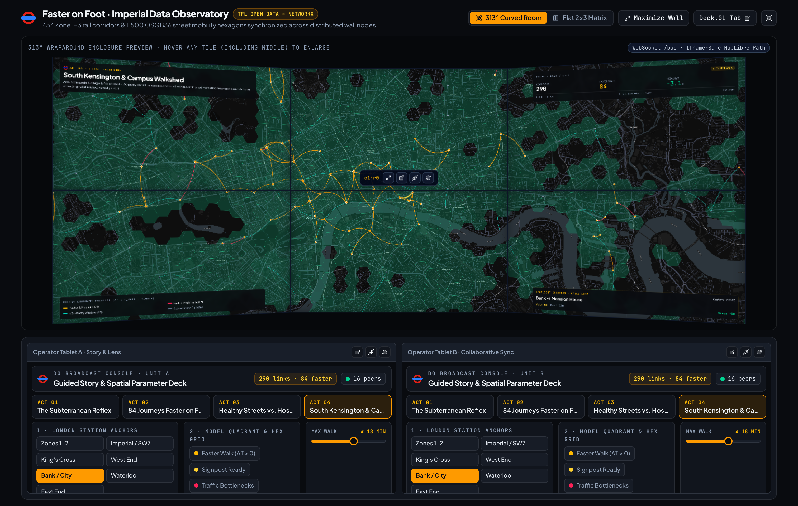
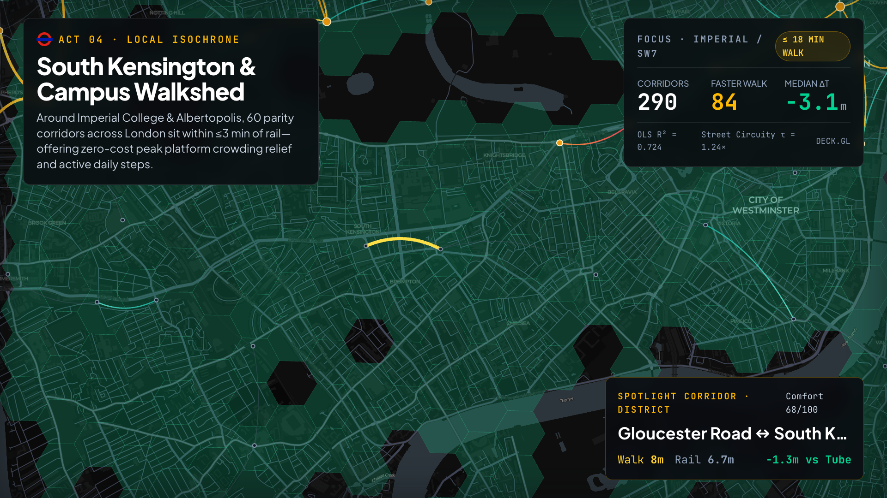

# Faster on Foot: Modeling the Tube Map's Geometric Illusion

**Imperial College London — Data for Humanity Internship Submission (Data Observatory Developer Playground)**

An interactive multi-screen spatial data science application built for Imperial's **313-degree, 64-screen Data Observatory**, combining **Python network graph & spatial hex modeling** with **real-time multi-operator WebSocket synchronization**.





---

## 1. The Thesis

Harry Beck's 1933 London Underground diagram is an icon of information design—but by straightening lines onto octilinear axes and expanding Central London's dense core, it systematically **warps commuters' mental model of physical distance**. Millions of journeys descend escalators, wait on platforms, and change lines underground between stations that sit **400–900 metres apart at street level**.

Using official datasets from **Transport for London (`walking.data.tfl.gov.uk` & Unified API)**, we ask two questions aligned with _Data for Humanity_:

1. **Where does walking on the street strictly beat subterranean rail door-to-door ($\Delta T = T_{\text{rail}} - T_{\text{walk}} > 0$)?**
2. **Where are geometrically faster walks undermined by hostile motor-vehicle traffic—pinpointing priority corridors for TfL _Healthy Streets_ investment?**

---

## 2. Data Science Pipeline (`/analysis`)

All quantitative modeling is reproducible via [`analysis/build_walking_model.py`](./analysis/build_walking_model.py) (detailed empirical tables in [`analysis/FINDINGS.md`](./analysis/FINDINGS.md)):

| Source Dataset                                                             | Scope & Resolution                                    | Role in Pipeline                                                                                                |
| :------------------------------------------------------------------------- | :---------------------------------------------------- | :-------------------------------------------------------------------------------------------------------------- |
| `LU_DLR_LO_NR_Zones 1-3 - approximate walk times.xlsx`                     | **441** adjacent Zone 1–3 rail links                  | Street walking times across Tube, DLR, Overground, Elizabeth line & NR                                          |
| `Central London journeys that be quicker to walk (TOP 10)_FINAL DATA.xlsx` | **52** cross-line shortcuts + pedometer steps         | Inter-line doglegs where street walking beats subterranean transfers                                            |
| `HAM_Cyn_Ped_HexData_v2.shp` (`EPSG:27700` OSGB36)                         | **15,041** hexagonal spatial cells across London      | 24h weekday pedestrian density (`PD_24hou_1`), AM-peak vehicle people-km (`PEOPLEKM_1`), cycle-km (`CycleKM14`) |
| TfL Unified API (`/Line/.../Route/Sequence/outbound` & `/StopPoint`)       | **20** rapid-transit lines (**331** modeled stations) | WGS84 station coordinates & ordered track topology                                                              |

### Modeling Highlights & Data Hygiene

- **Real-World Data Cleaning**: Automated entity resolution against TfL's NaPTAN station registry caught and corrected **6 clerical typos** inside TfL's published spreadsheets (including Row 282 of the Zones 1–3 sheet, which blended _Chalk Farm_ and _Belsize Park_ into `"Belsize Farm"`, alongside `"Caldedonian Road"`, `"Mornington Cresecent"`, `"Kiburn Park"`, `"Canonsbury"`, `"Tuffnell Park"`, and uncached Excel formula cells such as `'=60+52'`).
- **State-Expanded Transit Graph ($G = (V, E)$ in `networkx`)**: Models platform states `(station, line)` and street portals `(station, STREET)` with empirical vertical escalator/shaft access + headway wait penalties (`3.4 min` per end deep Tube; `2.5 min` sub-surface/Elizabeth; `2.7 min` Overground/DLR/NR), track run times + `0.45 min` dwell, and **4.5–5.5 min line interchange penalties** (including co-located OSI complexes $\le 230\text{m}$).
- **OLS Street Circuity Calibration**: Regressing street walk minutes on Haversine distance across $N = 456$ corridors yields $T_{\text{walk}} = 14.57\,d_{\text{crow}(\text{km})} + 0.92$ ($R^2 = 0.724$), corresponding to a mean Central London street detour factor of **$\bar{\tau} = 1.24\times$**.
- **Spatial Hexagonal Comfort Join & Four-Quadrant Policy Split**:
    - **83 corridors (18.2%)** beat rail outright ($\Delta T > 0$), saving a median **4.8 min** (up to **+32.7 min** on radial-orbital doglegs like _Kentish Town West ↔ Chalk Farm_ or _New Cross ↔ Deptford Bridge_).
    - **70 "Signpost Ready" Corridors (`nudge_gold`)**: Faster on foot _and_ routed through high-pedestrian, lower-traffic hexagons—actionable immediately via station exit signage.
    - **13 "Healthy Streets Priority" Corridors (`policy_priority`)**: Faster on foot geometrically, _yet_ exposed to heavy AM-peak vehicle people-km—pinpointing where wider pavements and crossings unlock latent active travel.
    - **58 "Parity Window" Corridors (`parity_nudge`)**: Within $\le 3\text{ min}$ of rail, offering zero-cost peak platform crowding relief.

---

## 3. Data Observatory Architecture

Built on the DSI starter stack (`TanStack Start` + `React 19` + `Nitro crossws` + `Deck.GL` + `MapLibre GL` + `Tailwind v4` + `vite-plus`) in strict adherence to [`BEST_PRACTICES.md`](./BEST_PRACTICES.md):

1. **Control vs. Screen Separation (`/control` $\leftrightarrow$ `/bus` $\leftrightarrow$ `/screen`)**:
    - Handheld operator consoles (`/control?operator=A`, `/control?operator=B`) broadcast throttled (`@tanstack/pacer`), schema-validated semantic intent messages—never transient frame dumps.
    - Late-joining display nodes and reconnecting tablets converge immediately from the `/bus` `hello` canonical snapshot, with `peerId` echo filtering and active-slider drag lockouts.
2. **GPU Context Survival (Dual Renderer)**:
    - Standalone screens (`window.self === window.top`) render rich **Deck.GL** layers (`PolygonLayer`, `LineLayer`, `ScatterplotLayer`).
    - Multi-iframe wall simulations (`window.self !== window.top`) automatically switch to an **iframe-safe imperative MapLibre GL** path (`setData` in-place, zero layer recreation) so 6+ concurrent display nodes stay well inside browser WebGL context budgets.
3. **Room-Scale Ergonomics & Bezel-Aware Choreography**:
    - Each `/screen?c=<col>&r=<row>&cols=<W>&rows=<H>` computes its exact sub-frustum via `WebMercatorViewport` pixel projection/unprojection.
    - Typography uses fluid room-scale viewport units (`vh`, `vw`, `clamp`) legible from 10m away, anchored exclusively to outer corner tiles so labels never slice across monitor bezels, with cubic-eased transitions and matte `#090B0F` cartography to prevent glare or vertigo inside the 313° cylinder.
4. **313° Curved Enclosure Simulator (`/`)**:
    - Toggle seamlessly between the **313° Curved Room Preview** (CSS 3D cylindrical wraparound projection of the 6 live `1920×1080` nodes) and the **Flat 2×3 Orthographic Matrix** without unmounting a single WebGL context.

---

## 4. Running Locally

### Prerequisites

- **Node.js** `>= 22.12.0` and `pnpm` (`10.x`)
- _(Optional, to re-run the Python data science pipeline)_ **Python** `>= 3.11` / [`uv`](https://docs.astral.sh/uv/)

### Start the Interactive Observatory Playground

```bash
pnpm install
pnpm exec vp run dev
```

Open **`http://localhost:5780/`**:

- `/` — 313° Curved Observatory Wall Simulator + Dual Operator Tablets (`A` & `B`)
- `/screen` — Standalone Full-HD **Deck.GL** display node
- `/control?operator=A` — Standalone handheld operator console

### Format, Type-Aware Lint, Unit Tests & Production Build

```bash
pnpm exec vp run ready
```

### Re-build the Canonical Dataset & Findings from Raw TfL Sources

```bash
uv run --project analysis python3 analysis/build_walking_model.py
```
